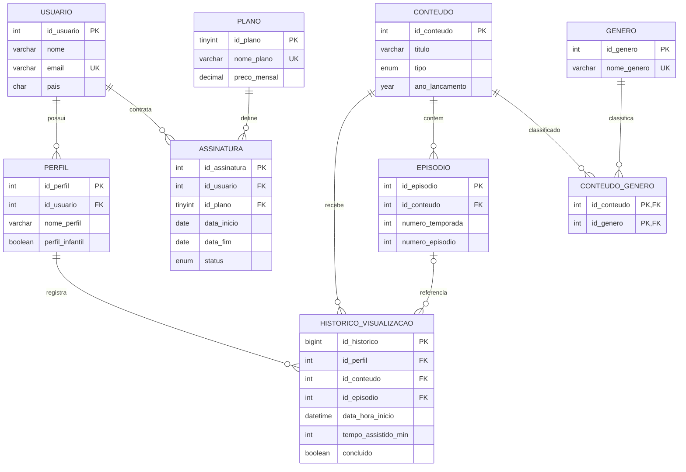

# Modelo de dados

O banco utiliza relacionamentos relacionais com chaves primárias e estrangeiras. O diagrama abaixo resume os relacionamentos centrais definidos em `database/schema.sql`.

## Observações sobre o modelo

- Usuários podem possuir vários perfis e assinaturas ao longo do tempo.
- Conteúdos e gêneros possuem relacionamento muitos-para-muitos, resolvido pela tabela associativa `conteudo_genero`.
- Um conteúdo do tipo série pode possuir episódios; o histórico pode apontar para um episódio específico.
- `id_episodio` é opcional no histórico, permitindo registros de filmes.
- A estrutura representa um cenário didático e usa dados fictícios de demonstração.
